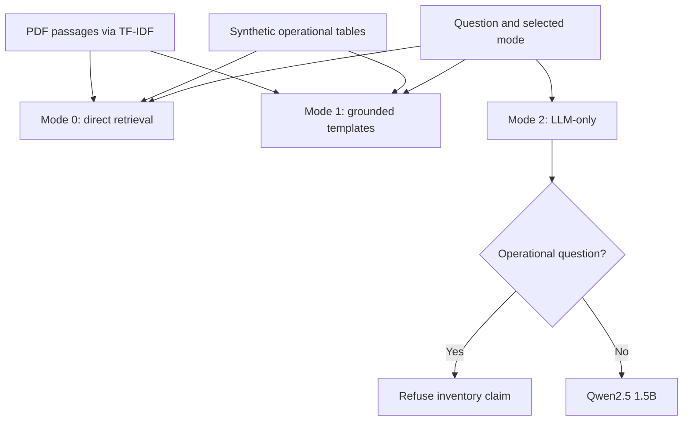

# Hospital Supply-Chain Chatbot

**Hamza Tariq · Data Analytics and AI Portfolio**

A domain chatbot prototype combining hospital inventory queries, document retrieval, and an open-source LLM to explore how answers can stay connected to their sources.

**Python · pandas · TF-IDF · scikit-learn · PyMuPDF · Hugging Face Transformers · LLM Evaluation**

[Project notebook](notebooks/hospital_supply_chain_chatbot.ipynb) · [Presentation](reports/hospital_supply_chain_chatbot_presentation.pptx) · [Evaluation prompts](evaluation/prompts.json) · [Setup](docs/setup.md)

## Project at a glance

| Scale | Project scope |
| ---: | --- |
| **200,000** | Synthetic inventory lots |
| **8,000** | Drug catalog entries |
| **80** | Storage locations across three simulated hospitals |
| **8,000** | Simulated cost-contract records |
| **6,383** | Document passages indexed in the saved run |
| **180** | Logged evaluation calls across 30 test prompts |

## Reported prototype results

The [project presentation](reports/hospital_supply_chain_chatbot_presentation.pptx) reports these outcomes:

| Measure | Reported result |
| --- | --- |
| Query resolution | **Under 10 seconds**, compared with a **15–45-minute** manual workflow |
| Retrieval-assisted mode | **Under 2% hallucination** |
| LLM-only mode | **10–15% hallucination on unblocked queries** |
| Ambiguous queries | **Approximately 40–50% abstention** |


## The problem

Inventory, lot-expiration details, procurement records, and reference documents often sit in separate sources. This project explores a conversational interface that routes a question to structured tables or document evidence and makes the answer's source visible.

## What the prototype does

- **Inventory and lot lookup:** resolves identifiers and filters synthetic stock records by drug, location, lot, or facility.
- **Document search:** retrieves relevant passages from the FDA Orange Book and ASHP corpus using TF-IDF and cosine similarity.
- **Retrieval-assisted answers:** formats inventory and contract information with table-field citations and shows source passages for product research.
- **LLM comparison:** uses Qwen2.5-1.5B-Instruct as a separate answer path, with a programmatic block on operational inventory claims.
- **Adversarial testing:** exercises normal requests, ambiguous questions, and prompts that attempt to override instructions or request sensitive information.

## Three answer paths

| Mode | Approach | Output |
| --- | --- | --- |
| 0 | Direct retrieval | CSV rows or quoted PDF passages with document/page/chunk references |
| 1 | Retrieval-assisted templates | Structured summaries, source citations, and inventory-ranked candidates |
| 2 | Guarded LLM-only | Generated responses without access to inventory or retrieved PDFs |

Mode 1 is labeled RAG in the original presentation; the supplied implementation uses templates to format its retrieved evidence.



## Evaluation coverage

The supplied test suite contains **10 normal, 10 ambiguous, and 10 adversarial prompts**. Its saved loop records 60 calls per mode, for 180 calls overall. Example cases cover stock queries, lot tracing, unclear product requests, instruction overrides, and requests for information the system should not claim to possess.

The portfolio emphasizes evaluation coverage and source traceability. Implementation and scoring details are documented in [technical notes](docs/technical_notes.md).

## Explore the repository

| Location | Contents |
| --- | --- |
| [notebooks/](notebooks/) | Hospital chatbot and synthetic dataset notebooks |
| [scripts/](scripts/) | Command-line synthetic-data generator |
| [evaluation/](evaluation/) | Prompt suite and saved evaluation design |
| [reports/](reports/) | Original project presentation |
| [references/](references/) | Separate concussion-domain RAG demonstration supplied with the project |
| [docs/](docs/) | Setup, data relationships, and technical notes |
| [archive/](archive/) | Original hospital notebook for provenance |

## Run the dataset generator

```bash
python scripts/generate_synthetic_data.py --output data/generated
```

The default configuration produces the four synthetic tables at the scale listed above. A smaller configuration is available for quick inspection. The chatbot additionally requires the original PDF corpus and the setup described in [docs/setup.md](docs/setup.md).

This is a coursework prototype using simulated operational data. It is not a clinical service or a live hospital integration.

Completed as group coursework in Boston University's Questrom MSBA program (BA840). Original collaborators: Hamza Tariq and Ahrar Karim.
